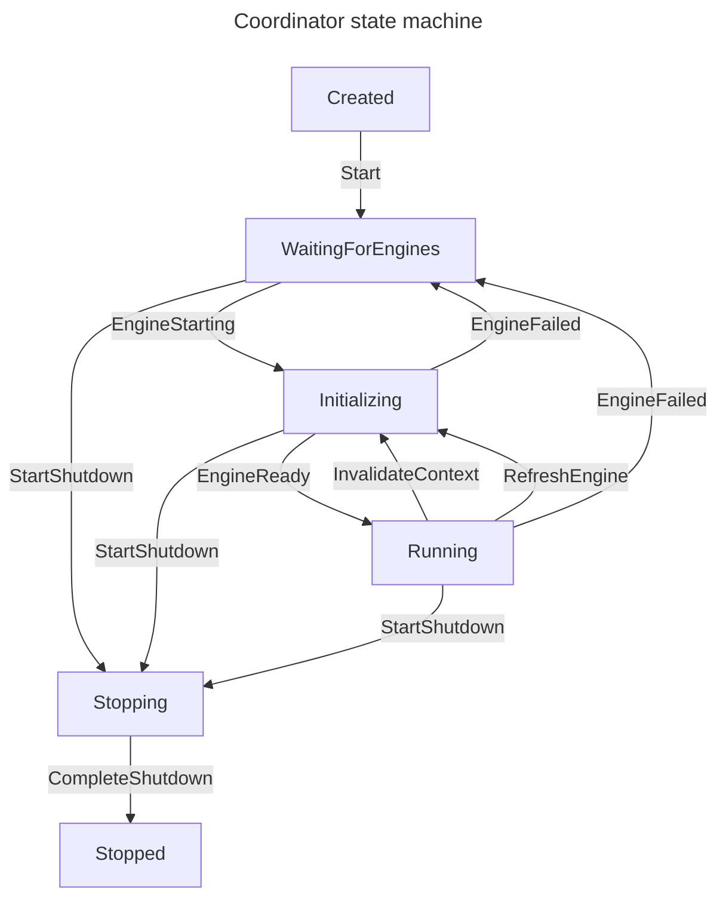

# Engine Coordinator state machine

A generation switch (`RestartWithDefinitionsAsync`) shuts the replaced coordinator down (`StartShutdown`, then
`CompleteShutdown`), so a replaced coordinator ends in `Stopped`; lookups on it are answered by the current
coordinator of its lineage (`Successor`). A shutdown reaches `Stopped` also when an engine fails to stop.

`StateMachineTransitionsTest` (in `Tests/OrchestrationEngines.Tests`) holds a snapshot of every transition
of this state machine and of the task state machine (`EngineTask`), so a change to either shows up in review; update
this diagram with it.
