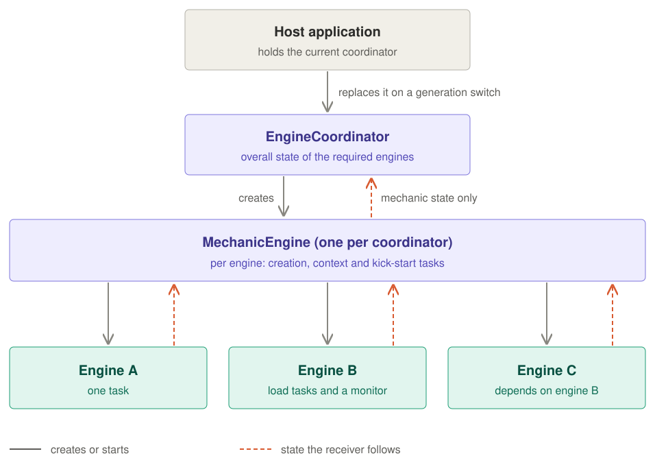
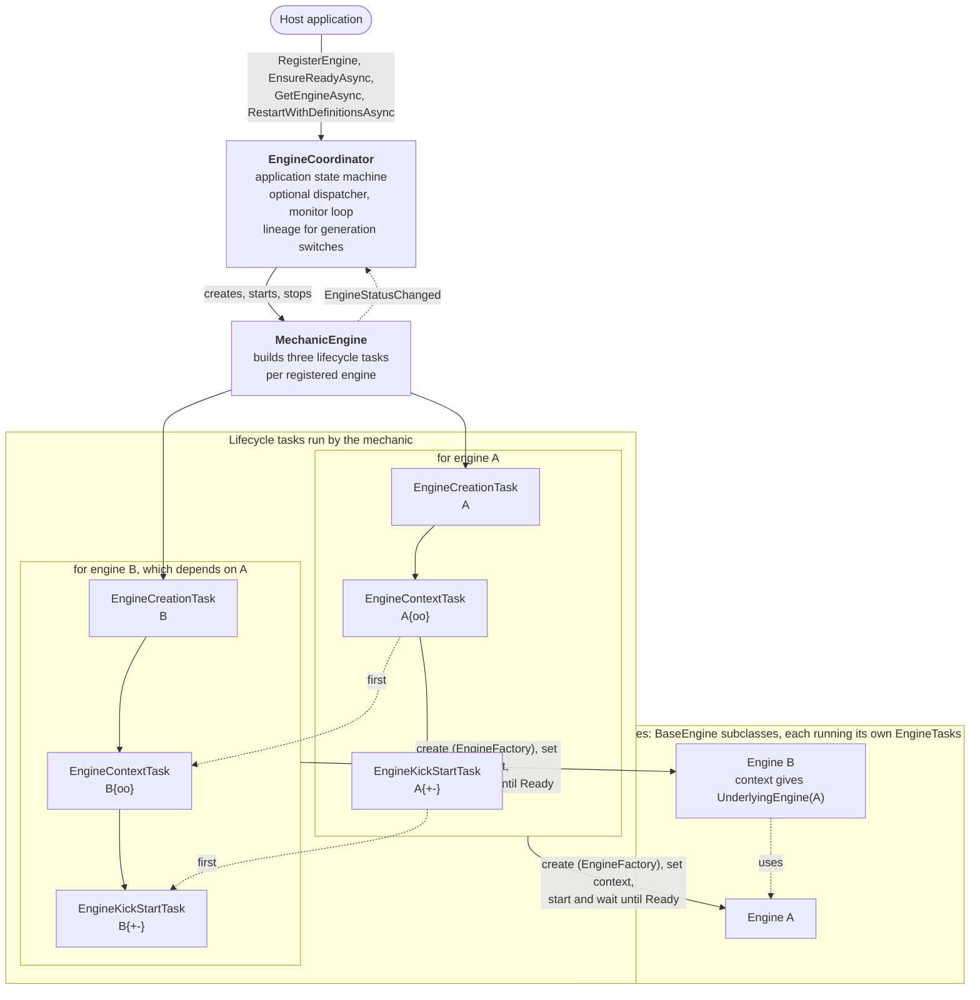
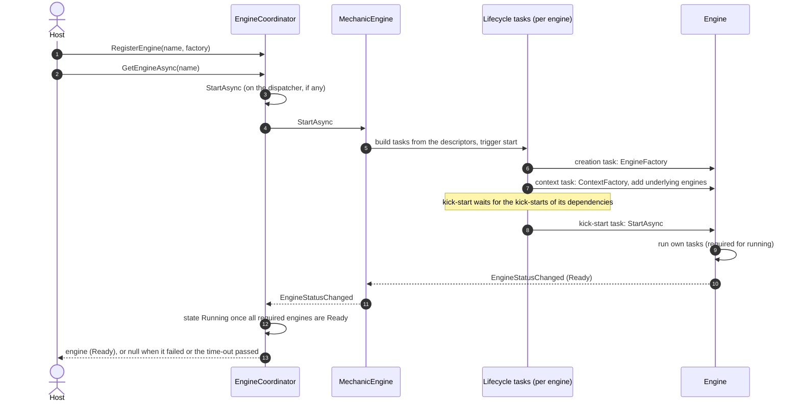
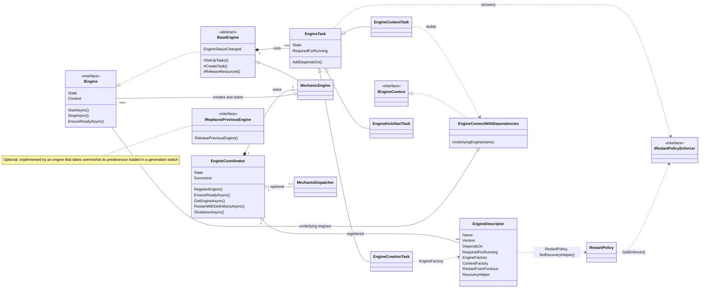

# Engine Orchestration Framework

## Overview

This repository implements a **dependency-aware engine orchestration framework** designed for applications composed of multiple interdependent runtime engines.

The framework provides:

- declarative engine configuration
- deterministic startup ordering
- dependency health propagation
- context-based dependency injection
- controlled recovery and restart
- coordinated application lifecycle management

It is suitable for complex systems where _startup correctness, dependency availability, and controlled recovery_ are first-class concerns.

---

## How the parts work together

The host talks to the **coordinator** only. The coordinator owns one **mechanic**, a meta-engine whose tasks create,
configure and start the host's **engines**. For every registered engine the mechanic builds three lifecycle tasks, and
it wires the dependencies between engines through those tasks: an engine is only kick-started once the engines it
depends on are Ready.

State flows upwards one level at a time: the coordinator follows only the mechanic's state, and the mechanic follows
the state of each engine. In more detail:

A typical start-up and lookup. With the dispatcher on, only the coordinator's start runs on it; the waits run on the
caller's side, so a slow engine does not hold up other calls.

The main types and how they relate:

---

## Core Concepts

The framework is structured around a small set of clearly separated concepts:

### 1. Engine Descriptor

`EngineDescriptor` is a _declarative definition_ of an engine.

It specifies:

- the engine’s logical name
- how to create a fresh engine instance
- how to compute its runtime context
- which other engines it depends on
- whether it is required for application readiness
- optional restart/recovery policy

Descriptors define _topology_, not behavior.  
They are collected before startup and remain fixed for the lifetime of a run.

Engine and task names are case-insensitive everywhere: in dependencies, lookups, context refreshes and definition
diffs. `AsBuilt` and `asbuilt` are the same engine. An engine refuses a second task under a name it already uses
(`Load` and `load` included): `CreateTask` throws an `ArgumentException`, and during a set-up the start fails.

---

### 2. Engine Context

`IEngineContext` represents immutable runtime context passed into an engine.

Key properties:

- contexts are **composed**, not mutated
- dependency engines are exposed via context
- invalidation replaces the entire context and triggers restart

Important implementations:

- `NoContext` — explicit “no context” null-object
- `EngineContextWithDependencies` — wraps a base context and exposes dependency engines

This approach avoids construction-time coupling while still enabling inter-engine interaction.

---

### 3. Engine Tasks

`EngineTask` is the smallest unit of orchestration.

Each engine is decomposed into a **task DAG**, typically consisting of:

1. creation
2. context resolution
3. kick-start / readiness

Characteristics:

- tasks form a directed acyclic graph (DAG)
- tasks have explicit dependency edges
- tasks are driven by a state machine
- failure and recovery are localized to the task level

Tasks are _restartable_ and _observable_, and they drive engine lifecycle state.

A task is either **required for running** (the engine is Ready once all of these have completed successfully) or a
**background task**, which never holds up readiness. A background task may keep running until the engine stops, as a
change monitor does; no readiness wait includes background tasks.

Recovery and restarts:

- A task with a recovery policy (`SetRecovery`) that fails, times out, or is cancelled from outside (its own token was
  not cancelled) goes to `Recovering`, waits, and runs its work again. Its state message says why.
- `RestartPolicy` limits the restarts: at most `MaxRestartsInWindow` within `Window`, and at most
  `MaxConsecutiveRestarts` in a row without a successful run, however long each attempt takes (the window alone never
  gives up on slow failures). The wait between restarts doubles from `InitialBackoff` up to `MaxBackoff`. A success or a
  reset starts counting again.
- A task that starts while one of its dependencies has failed ends `DependencyFailed` at once.

Resets:

- A reset ends the current run: the run's outcome is dropped (a run generation, checked under the task's trigger lock,
  for the work and for the recovery), its token is cancelled, and whoever waited on it is released when the next run
  completes.
- A run never runs next to the run before it: a reset, an end or a time-out cancels the run's token but cannot stop its
  work, so the next run (or the recovery) starts once that work has ended. Work must therefore check its token often:
  until it notices, the next run waits. After `EngineTask.PreviousRunWarningAfter` (30 s) the wait logs a warning and
  shows it in the task's message, and goes on waiting.
- Work reports its progress to `EngineTask.Running`, its own task, rather than to a task looked up by name: once the
  engine has built a new task set, a name finds the successor.
- A task cancelled from outside is reset too, as long as its engine is live; once the engine is stopped, its cancelled
  tasks stay cancelled.
- `BaseEngine.ResetTasksAsync(taskNames, resetDependentTasks)` resets tasks by name (ignoring case), and with
  `resetDependentTasks` every task that depends on them, directly or not; the coordinator's
  `ResetTasksForEngineAsync(engineName, taskNames, resetDependentTasks)` does it for one engine, once its start has
  settled (it is `Ready`, or its start failed); after a generation switch, on the next generation. An unknown name
  throws an `ArgumentException`, and a stopped engine an `InvalidOperationException`, before anything is reset. The
  tasks then run again: a Ready engine goes to `Starting` and back to `Ready`.
- Every reset of several tasks (also `TriggerResetAsync`) goes in two passes. First it ends the current run of every
  task (its outcome is dropped, its token cancelled), dependents before the tasks they depend on, so no dependent goes
  on running on a dependency that is being reset. Then it puts the tasks back in Created, dependencies first, so no task
  of the set starts (by a caller, or by a dependency's old run) on a dependency of the set that is still to be reset. A
  reset does not wait for the work it cancels: work that ignores its token goes on until it checks.

Time: every task has a `TimeProvider` (its time-out, its run times, the backoff of a policy set with `SetRecovery`);
`BaseEngine.TimeProvider` passes one to the tasks an engine creates. Tests pass a clock they advance themselves.

Time-out: with `SetTimeOut` the work runs on the thread pool and races the time-out, so synchronous work times out too
(its token is cancelled and its outcome dropped; a recovery runs once the work has stopped). A stop or reset during the
race is a cancellation, not a time-out.

---

### 4. Engine

An `IEngine` is a long-lived runtime component.

Engines:

- do not manage their own startup ordering
- do not directly manage dependencies
- expose lifecycle methods (`StartAsync`, `EnsureReadyAsync`, `StopAsync`)
- observe a cancellation token

Concrete engines typically inherit from **`BaseEngine`**, which:

- owns the engine’s task DAG
- derives engine state from the states of its required tasks (`Created → Starting → Ready`, or `Faulted` when one
  failed; `Stopped` once the engine is stopped, or when a required task was cancelled and none failed)
- checks a new task set for cyclic dependencies before it replaces the current one. A start whose set-up fails (a
  cycle, or `SetUpTasks` throwing) publishes none of the new set, logs an error, leaves the engine `Faulted` with no
  tasks (`Stopped` if the engine was stopped meanwhile), and throws; the next start, or a recovery retry, builds the
  set again, and still waits for the work the replaced set left running
- coordinates cancellation and reset behavior
- shields itself from the code it calls back: a subscriber to `EngineStatusChanged`, or to a task's
  `CompletedStateReached`/`FailedStateReached`, that throws is logged and skipped, and the other subscribers (among
  them the tasks that depend on it) still get the change. This covers what a subscriber throws before it returns: the
  events' handlers return `void`, so an `async` subscriber must catch what it throws after its first `await` itself. A callback
  registered on a work's cancellation token that throws is logged too, and the stop, cancellation or time-out goes
  ahead

To wait for one task, `EnsureTaskReadyAsync(taskName)` starts it (and what it depends on) if needed and returns once
it has completed with success. If it ended otherwise (`Failed`, `TimedOut`, `DependencyFailed`, `RecoveryFailed` or
`Cancelled`) it throws an `EngineTaskNotReadyException` with the task's name, its final state and its fail reason; when
the task's work (or recovery) threw, that exception is the inner exception. An unknown task name throws an
`ArgumentException`. A restart or reset that ends the task during the wait is not a failure: the wait goes on with the
task's next run; if the restart's set no longer has the task, the wait reports how the task it waited for ended.
Cancelling the wait's token ends the wait only. `EnsureReadyAsync(taskName)` and `EnsureTasksReadyAsync` still only wait.

Stopping is final: `StopAsync` cancels the engine's token, cancels the tasks that have not started their work, and the
engine reports `Stopped` from then on: a reset of its tasks or a start after the stop does nothing. A start replaces the
task set; the previous set's tasks that have not completed (a background monitor, tasks someone started or waits on) are
ended first: they go to Cancelled, which releases their waiters, and never run again. The new set's tasks start once the
work of the replaced set has stopped, so the two sets' work never runs at the same time. Once its work has ended, each
task of the replaced set has its token cancelled (a completed task's too, so work it left running stops) and its token
source disposed; a token whose source is disposed still reports cancellation, but its `WaitHandle` throws
`ObjectDisposedException`. The same holds for a task's token after a reset or a recovery, and for the engine's token
after a stop.

---

### 5. Mechanic Engine

The **`MechanicEngine`** is a _meta-engine_.

Its responsibilities:

- build the engine task DAG from descriptors
- create engine instances
- assign contexts
- start, stop, reset, and restart engines
- propagate dependency failures
- enforce recovery policies

The mechanic itself is an engine and participates in the same lifecycle model.

An engine's lifecycle tasks (creation, context, kick-start) recover by the descriptor's `RestartPolicy`, which is
`RestartPolicy.Default` unless the host sets another. A recovery helper that is set (`SetRecoveryHelper`) wins over it,
and `RestartPolicy = null` turns recovery off. So an engine whose load fails is retried with backoff, and each attempt
is logged. An engine whose start failed reports `Faulted` between attempts, and is started again (with a new task set,
see below) for the next one; `Faulted` is final only once the policy gives up, which a lookup sees (it waits
for the retries, and then gets null). With `RestartPolicy.Default` (five restarts in a row, the wait doubling from 1 s
up to 10 s) a permanent error is given up on after about 25 seconds and six attempts. A host that needs a failed load
to fault for good at once sets `RestartPolicy = null`. The retries also delay what waits for the engine: a generation
switch that waits until the next generation is ready keeps the previous generation (and the engine handed over) until
the retries have ended, and with the dispatcher on, the coordinator calls queued behind the switch (a shutdown, a
context refresh, another switch) wait as well.

When the descriptor's recovery retries an engine's kick-start, the engine is started again with a new task set if it
is `Faulted`, or `Stopped` by one of its own tasks being cancelled from outside while the engine itself is live. Until
the new set is built, nothing starts the old one and readiness waits wait for the new set. A lookup that arrives while
the kick-start retries waits for the retries, and gets null only once the kick-start has given up. An engine that was
stopped on purpose is never started again.

---

### 6. Engine Coordinator

The **`EngineCoordinator`** is the application-facing entry point.

It:

- collects engine descriptors before startup
- creates and starts the mechanic
- tracks aggregate engine readiness
- exposes application-level lifecycle state
- handles context invalidation and shutdown

Internally, it maintains an **application-level state machine** that translates engine-level signals into coarse states:

- `Created`
- `WaitingForEngines`
- `Initializing`
- `Running`
- `Stopping`
- `Stopped`

The coordinator is intentionally conservative: once shutdown starts, it does not accept new operational triggers.

Shutdown stops the engines dependents first: an engine is stopped only once every engine that depends on it (its
descriptor's `DependsOn`) has been stopped, that is, their `StopAsync` has returned. Engines that do not depend on each
other, directly or through other engines, are not ordered, so they stop together, and an engine that is slow to stop holds back only the engines it depends
on. An engine that throws while stopping is logged and counts as stopped; the shutdown rethrows the first such exception
once every engine has been stopped. An engine whose `StopAsync` never returns keeps its dependencies running. This order
applies to the coordinator's shutdown (also of a generation replaced by a switch), not to the engines a switch rebuilds
from scratch, which it stops together before the next generation starts.

Its readiness follows the required engines only: an engine registered as not required for running may still be
loading, or have failed, while the coordinator is `Running`.

`EnsureEngineTaskReadyAsync(engineName, taskName)` does the same for one engine's task, starting the coordinator if
needed. It waits for the engine to start first (its kick-start, which ends once the engine is `Ready` or failed), so a
task that completes early is reported once the engine is `Ready`. An engine that could not be created or started is
reported by the mechanic's task that failed: its creation task, named after the engine, or its kick-start task. An
unknown engine name throws an `ArgumentException`. A generation switch during the wait is answered by the next
generation, as engine lookups are; if the next generation no longer has the engine, that is an unknown engine
(`ArgumentException`).

#### Generation switch

Descriptors are fixed for the lifetime of a coordinator. To change them, `RestartWithDefinitionsAsync` starts a next
coordinator (a generation) with the new descriptors and shuts the current one down:

- `EngineDefinitionDiff` compares the descriptors by name and version: a version bump marks that engine as changed,
  and every engine that depends on it (also indirectly) as having a changed dependency.
- An engine that existed before is created through its descriptor's restart factory (`SetRestartFactory`), which is
  handed the previous engine once (`EngineRestartInput`, with what changed), so it can take over loaded state. A later
  switch starts from the factory the descriptor was registered with, so generations do not keep each other alive.
- An engine that existed before but has no restart factory is rebuilt from scratch with its regular factory. Its
  previous engine is stopped before the next generation starts, so two copies of its data are never loaded at the same
  time.
- The replaced coordinator is shut down completely: every engine stops, whatever its state, and its mechanic is
  cancelled, so no kick-start or recovery goes on in it.
- All generations of a coordinator share a lineage that knows the current one (`Successor`). A lookup on a replaced
  coordinator, also one that was already waiting, is answered by the current coordinator; an engine that the switch
  left out gives null.
- With `waitUntilReady: false` the switch returns once the next generation has started; the previous engines are then
  usually stopped before their replacements start, so a restart factory must be able to take over a stopped engine's
  state.

---

## Lifecycle Summary

At a high level:

1. Engines are **registered** via descriptors.
2. Coordinator is **started**.
3. Mechanic builds the task DAG.
4. Tasks execute respecting dependencies.
5. Engines reach **Ready**.
6. Application enters **Running** state.
7. Context invalidation or failure causes controlled re-initialization.
8. A change of descriptors is a generation switch: a next coordinator, which takes over what it can, replaces the
   current one, which is shut down.
9. Shutdown cancels all work deterministically.

---

## Design Principles

- **Declarative topology**  
  Startup order is derived, not coded.

- **Dependency-driven execution**  
  No imperative “start engine X then Y”.

- **Context immutability**  
  Replace, don’t mutate.

- **Explicit recovery**  
  Restart behavior is policy-driven.

- **Cooperative cancellation**  
  Each coordinator has a cancellation scope linked to the application token (also across generation switches), and
  each engine and task has its own, which a stop or a reset cancels. An engine created with `BaseEngine(logger)` is not
  linked to the coordinator's scope; the coordinator stops it explicitly. Work must observe its token: a stop takes
  effect once it does.

- **Observability first**  
  States and transitions are visible and loggable.

---

## Intended Use

This framework is intended for:

- multi-engine backends
- complex startup graphs
- systems requiring deterministic recovery
- environments where partial readiness is unacceptable

It is **not** intended as a lightweight task scheduler or job runner.

---

## Status

The framework is structurally complete and documented in code. Its behavior is pinned by the tests in
`tests/OrchestrationEngines.Tests`, including a snapshot of every state machine transition
(`StateMachineTransitionsTest`).

Known open issues:

- the dispatcher (`useDispatcher: true`, the default) runs every coordinator call one at a time, so one slow lookup
  blocks the others;
- nothing supervises an engine after its kick-start: a reload that fails leaves the engine `Faulted` until something
  starts it again.
